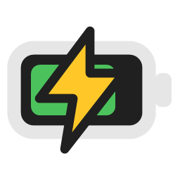
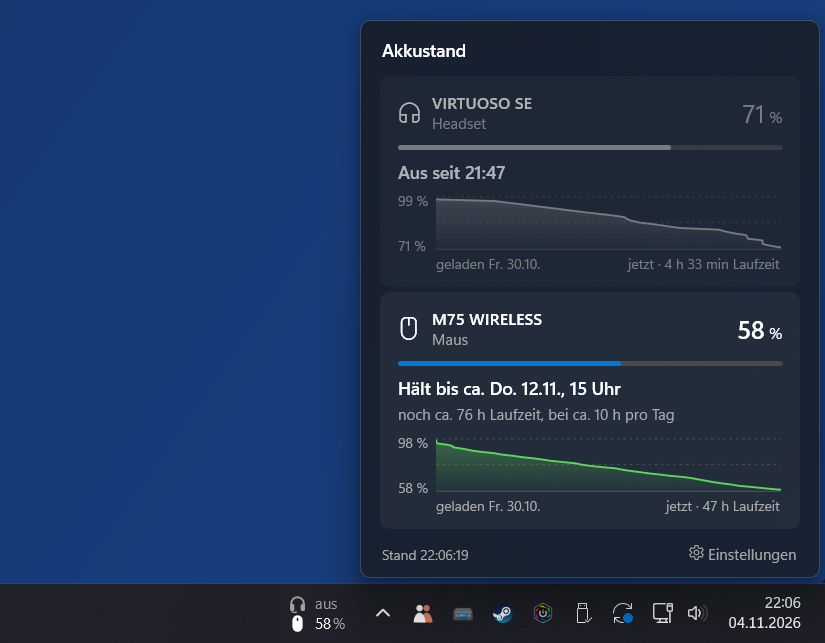
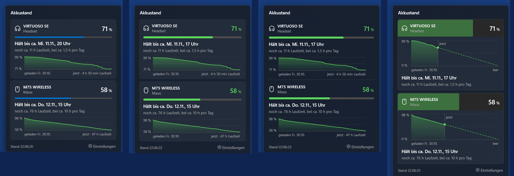
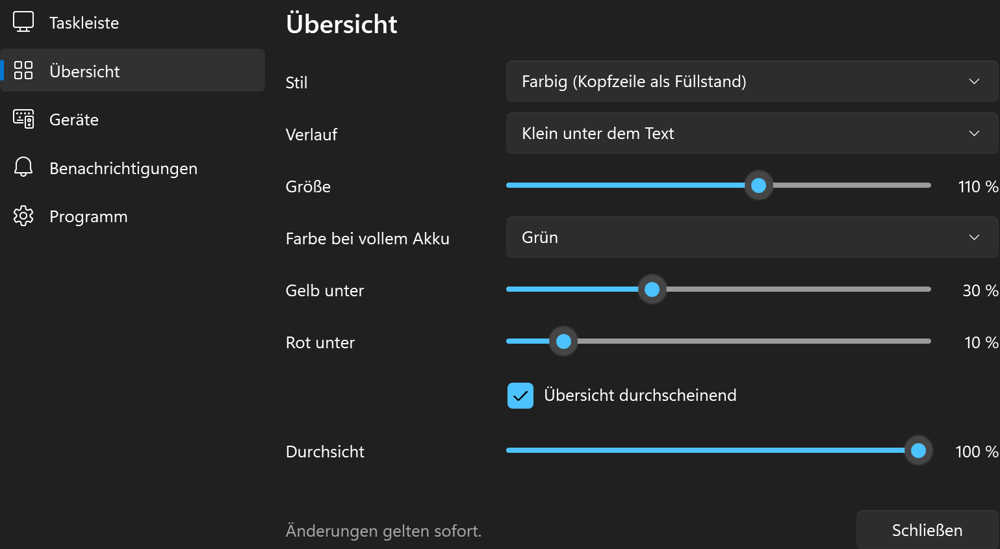
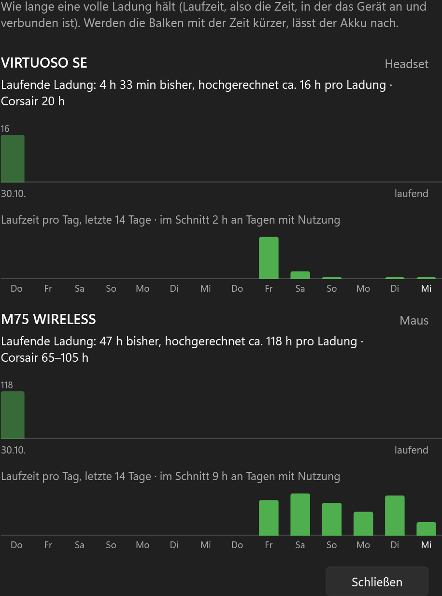
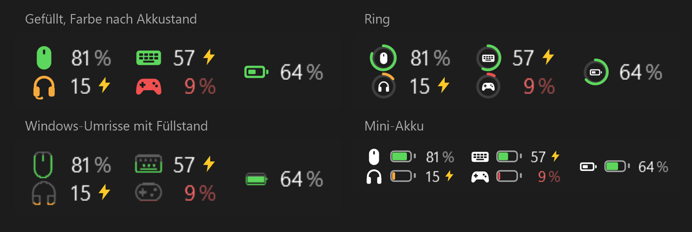

  

<h1 align="center">Xviews ChargeBar</h1>

  <a href="README.md">Deutsch</a> · <b>English</b>

  <b>The battery level of your Corsair devices, right in the taskbar.</b> 
  Mouse, headset, keyboard and controller at a glance. With time left, history and notifications.

  

  <a href="#how-it-works">How it works</a> ·
  <a href="#features">Features</a> ·
  <a href="#download">Download</a> ·
  <a href="#good-to-know">Good to know</a>

Private project, not affiliated with Corsair. “Corsair” and “iCUE” are trademarks of Corsair Memory, Inc.

---

iCUE only shows the battery as a small icon in the notification area. What is the exact percentage? Is the headset still charging? Will the mouse last until tomorrow? **ChargeBar shows it permanently next to the clock:** the exact percentage for every device, plus the time left from its own measurement. The free Windows tool reads the battery level through the official iCUE SDK.

  

The screenshots show the German version. The app is available in German and English.

## How it works

| 1️⃣ Start | 2️⃣ Read | 3️⃣ Click |
|---|---|---|
| Run the EXE and install it if you like. iCUE has to be running, that's all it needs. | Your devices appear next to the clock, in two lines like time and date. As soon as the cable is plugged in, a bolt appears. | One click on the bar shows every device with time left and history. Right-click for battery health and settings. |

## Features

**Taskbar**
- 🔋 **Battery level next to the clock:** mouse, headset, keyboard and controller, in two lines or side by side, also on other monitors if you like. Or as separate icons in the notification area.
- 🎨 **Four icon styles:** filled, ring, Windows outlines or mini battery. Color white, by battery level, as fill level, in the Windows accent color or in a color of your choice.
- ⚡ **Charging detected instantly:** As soon as the charging cable is plugged in, a bolt replaces the percent sign.
- 🚨 **Critical battery stands out:** Below 10 % the number turns bold and pulses gently.

**Overview**
- ⏱️ **Time left from its own measurement:** ChargeBar measures how fast the battery drops, per hour the device is on. Breaks and devices that are switched off don't skew anything.
- 📅 **“Lasts until about Thu 12 Nov, 3 pm”:** The time is based on how many hours a day you usually use the device. While charging, it shows when it will be full.
- 📈 **History since the last charge,** small below the text or large with a dashed forecast until empty or full.
- 🪟 **Four styles:** Windows 11, cards with border, plain or colored. Translucent like glass if you like, strength adjustable with a slider.
- 🌈 **Colors your way:** You choose when the battery counts as yellow and red, and the color for a full battery (or any color you like).
- ✏️ **Rename devices,** for example “Office mouse” instead of “M75 WIRELESS”. Right-click a device to collapse or hide it.
- 🩺 **Battery health:** one bar per charge shows how long it lasted, plus the runtime per day over the last 14 days. If the bars get shorter, the battery is wearing out.

**Notifications**
- 🔔 **Battery low** (threshold adjustable), **time running out**, **charge target reached** (80, 90 or 100 %) and optionally **device disconnected**. Each notification comes only once, even after a restart.
- 🌙 **Evening reminder:** when a device is likely to run out tomorrow. Time and condition are adjustable.
- 🎮 **Quiet while gaming:** While a game or video runs in full screen, notifications wait until afterwards and come as one.

**Also**
- 📦 **Installs itself, without admin rights:** Start menu, entry under “Installed apps”, autostart. Running it without installing works too.
- 🔄 **One-click updates:** The app announces new versions including what's new, checks the checksum and installs after asking. Settings and history are kept.
- 🌗 **Theme like Windows**, light, dark or black for OLED screens.
- 🌍 **German and English,** automatically following the Windows language or set manually.

   
  The four overview styles: Windows 11, cards, plain and colored with large history

<table>
  <tr>
    <td width="50%"></td>
    <td width="50%"></td>
  </tr>
  <tr>
    <td align="center">Settings</td>
    <td align="center">Battery health</td>
  </tr>
</table>

   
  The four icon styles for the taskbar

## Download

| File | Size | Note |
|---|---|---|
| [`XviewsChargeBar.exe`](https://github.com/xviews/xviews-chargebar/releases/latest/download/XviewsChargeBar.exe) | approx. 72 MB | runs right away, installing is optional |

**Requirements:** Windows 10 or 11 (64 bit) and Corsair iCUE 5 running in the background. Wireless devices whose battery level iCUE shows. ➡️ All versions and checksums under **[Releases](../../releases)**.

**Security:** The checksums (SHA-256) of every version are in the release notes. You can check them yourself in PowerShell with `Get-FileHash .\XviewsChargeBar.exe`. Every version is also scanned on VirusTotal, the results are linked in the release notes as well.

<b>First start</b>

- If SmartScreen says “Unknown publisher”, click **“More info”** and then **“Run anyway”**. The EXE is not signed because a certificate costs money.
- ChargeBar asks whether it should install itself. It then lives in `%LOCALAPPDATA%\Programs\Xviews ChargeBar`, with a Start menu entry and autostart. No admin rights needed.
- To access iCUE, ChargeBar needs the file `iCUESDK.x64_2019.dll` from Corsair. It may not be shipped with the app. ChargeBar looks for it on your PC (for example from Stream Deck) and otherwise offers to download the official package from Corsair. The checksum is built in.
- Settings and history are stored in your Windows user folder (`%LOCALAPPDATA%\XviewsChargeBar`). The app shows the folder under **Settings → App**. When uninstalling, you can choose whether it stays or gets deleted.

## Good to know

- The time left is an estimate. At first ChargeBar uses Corsair's figures, after a few hours its own measurement, and after a day it knows your usual use.
- Use at your own risk.
- 🚫 The tool collects no data and sends nothing to me.

<b>When the app goes online</b>

- **Update check:** The public release page on GitHub is queried, once a day by default. Adjustable in the settings: on every start, once a day, once a week or never.
- **iCUE SDK:** Only if the file is missing on your PC and you agree to the download. Then the official package from Corsair is loaded from GitHub.
- When you trigger something yourself, for example opening the project page or a link under Info.

The battery level itself only comes from iCUE locally and never leaves your PC.

## About the name

It all started with Counter-Strike 1.5 and later 1.6. If you wanted to play, you needed a name, and mine was supposed to mean something: **X** stands for the unknown, **views** for seeing. So Xviews means: seeing the unknown. The fact that it sounded a bit like X-ray and wallhack made quite a few opponents nervous. We still played fair. 😉

And ChargeBar? **Charge** for the battery, **Bar** for the bar it sits in. Here the unknown is very concrete: how much battery is left before the mouse gives up in the middle of a match.

<b>Xviews ChargeBar: seeing the unknown, battery in view.</b>

## Reporting issues

Bugs and wishes are welcome under **[Issues](../../issues/new/choose)**, ideally with a screenshot, Windows version and device names. German or English, both are fine.

## Terms of use

Xviews ChargeBar is **free for private use**. Passing on the unchanged program file is allowed.

What is not allowed, and components &amp; sources used

Not permitted: selling, modifying the program, reverse engineering (decompiling, disassembling), taking program code or parts of it into other software, and feeding the program or its code into AI systems to analyze or rebuild it.

The binding version is the German one in [LICENSE.txt](LICENSE.txt).

© 2026 Xviews. All rights reserved.

**Components & sources used**

- [iCUE SDK](https://github.com/CorsairOfficial/cue-sdk), © Corsair, not included (looked for on your PC or downloaded from Corsair on request)
- [.NET / WPF](https://github.com/dotnet/wpf), MIT license
- Icons from the Windows font [Segoe Fluent Icons](https://learn.microsoft.com/windows/apps/design/style/segoe-fluent-icons-font), © Microsoft

The full license texts are in the app under **Info → Show licenses**.

