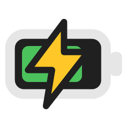
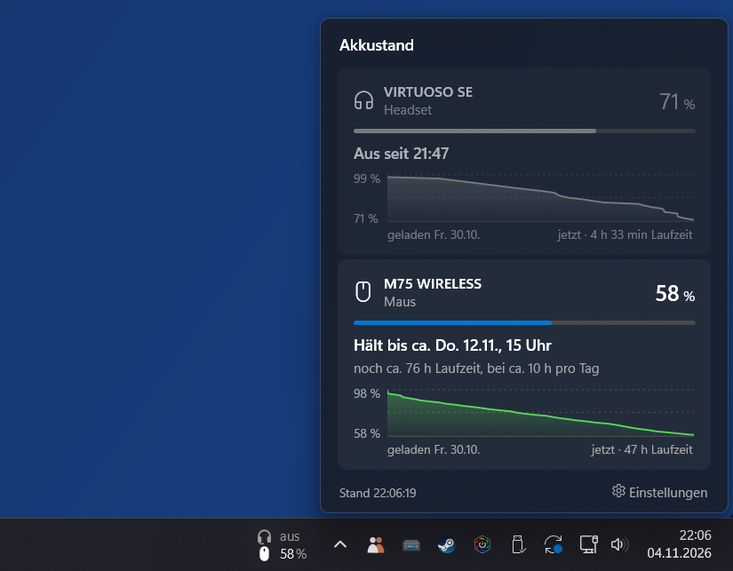
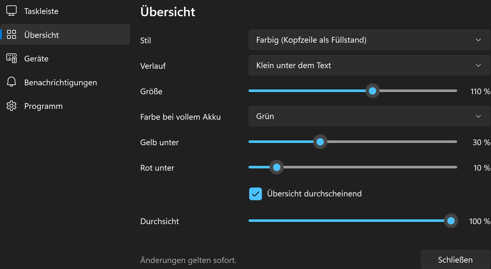
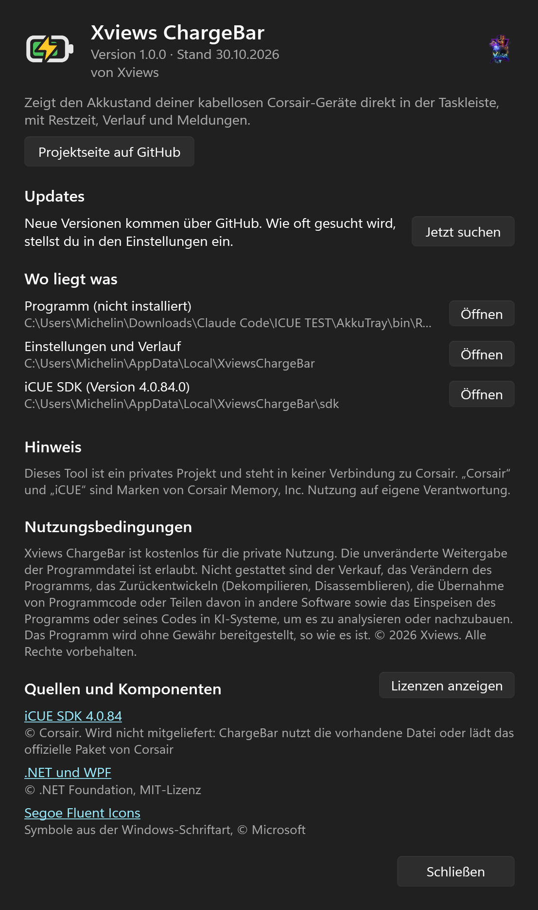
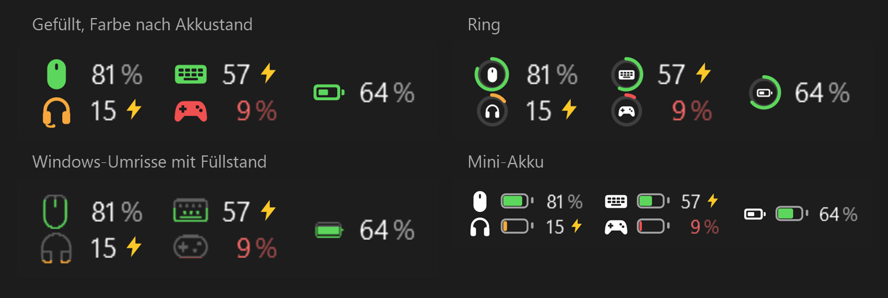

  

<h1 align="center">Xviews ChargeBar</h1>

  <b>Der Akkustand deiner Corsair-Geräte, direkt in der Taskleiste.</b> 
  Maus, Headset, Tastatur und Controller auf einen Blick. Mit Restzeit, Verlauf und Meldungen.

  

  <a href="#so-gehts">So geht's</a> ·
  <a href="#funktionen">Funktionen</a> ·
  <a href="#download">Download</a> ·
  <a href="#wichtig">Wichtig</a>

Privates Projekt ohne Verbindung zu Corsair. „Corsair“ und „iCUE“ sind Marken von Corsair Memory, Inc.

---

iCUE zeigt den Akku nur als kleines Batteriesymbol im Infobereich. Wie viel Prozent sind es genau? Lädt das Headset noch? Hält die Maus bis morgen? **ChargeBar zeigt es dauerhaft neben der Uhr:** die genaue Prozentzahl für jedes Gerät, dazu die Restzeit aus eigener Messung. Das kostenlose Windows-Tool liest den Akkustand über das offizielle iCUE SDK.

  

## So geht's

| 1️⃣ Starten | 2️⃣ Ablesen | 3️⃣ Draufklicken |
|---|---|---|
| EXE starten, auf Wunsch installieren. iCUE muss laufen, mehr braucht es nicht. | Die Geräte erscheinen neben der Uhr, zweizeilig wie Uhrzeit und Datum. Steckt das Kabel, erscheint sofort der Blitz. | Ein Klick auf die Leiste zeigt jedes Gerät mit Restzeit, Verlauf und Herstellerangaben. |

## Funktionen

**Taskleiste**
- 🔋 **Akkustand neben der Uhr:** Maus, Headset, Tastatur und Controller, zweizeilig oder nebeneinander, auf Wunsch auch auf weiteren Bildschirmen. Alternativ als einzelne Symbole im Infobereich.
- 🎨 **Vier Symbol-Stile:** gefüllt, Ring, Windows-Umrisse oder Mini-Akku. Farbe weiß, nach Akkustand, als Füllstand oder in der Windows-Akzentfarbe.
- ⚡ **Laden sofort erkennen:** Sobald das Ladekabel steckt, ersetzt ein Blitz das Prozentzeichen.

**Übersicht**
- ⏱️ **Restzeit aus eigener Messung:** ChargeBar misst, wie schnell der Akku sinkt, und zwar pro Stunde, in der das Gerät an ist. Pausen und ausgeschaltete Geräte verfälschen nichts.
- 📅 **„Hält bis ca. Fr. 6.11., 14 Uhr“:** Der Zeitpunkt richtet sich danach, wie viele Stunden am Tag du das Gerät üblicherweise nutzt.
- 📈 **Verlauf der letzten Stunden** als kleines Diagramm, dazu die Herstellerangaben zu Laufzeit und Ladedauer, solange noch nicht genug gemessen ist.
- 🩺 **Akku-Gesundheit:** wie lange eine volle Ladung tatsächlich hält, verglichen mit den ersten Ladungen und der Herstellerangabe.

**Meldungen**
- 🔔 **Akku niedrig** (Grenze einstellbar), **Restzeit knapp**, **Ladeziel erreicht** (80, 90 oder 100 %) und auf Wunsch **Gerät getrennt**. Jede Meldung kommt nur einmal, auch nach einem Neustart.

**Außerdem**
- 📦 **Installiert sich selbst, ohne Adminrechte:** Startmenü, Eintrag unter „Installierte Apps“, Autostart. Ohne Installation starten geht auch.
- 🔄 **Updates mit einem Klick:** Die App meldet neue Versionen, prüft die Prüfsumme und installiert nach Rückfrage. Einstellungen und Verlauf bleiben erhalten.
- 🌗 **Design wie Windows**, hell oder dunkel.

<table>
  <tr>
    <td width="50%"></td>
    <td width="50%"></td>
  </tr>
  <tr>
    <td align="center">Einstellungen</td>
    <td align="center">Info</td>
  </tr>
</table>

   
  Die vier Symbol-Stile für die Taskleiste

## Download

| Datei | Größe | Hinweis |
|---|---|---|
| [`XviewsChargeBar.exe`](https://github.com/xviews/xviews-chargebar/releases/latest/download/XviewsChargeBar.exe) | ca. 72 MB | läuft sofort, Installation optional |

**Voraussetzungen:** Windows 10 oder 11 (64 Bit) und Corsair iCUE 5, das im Hintergrund läuft. Kabellose Geräte, deren Akkustand iCUE anzeigt. ➡️ Alle Versionen und Prüfsummen unter **[Releases](../../releases)**.

**Sicherheit:** Die Prüfsummen (SHA-256) jeder Version stehen im Release-Text. Mit `Get-FileHash .\XviewsChargeBar.exe` in PowerShell kannst du sie selbst prüfen. Jede Version wird außerdem bei VirusTotal geprüft, die Ergebnisse stehen mit Link ebenfalls im Release-Text.

<b>Beim ersten Start</b>

- Meldet SmartScreen „Unbekannter Herausgeber“, auf **„Weitere Informationen“** und dann auf **„Trotzdem ausführen“** klicken. Die EXE ist nicht signiert, weil ein Zertifikat Geld kostet.
- ChargeBar fragt, ob es sich installieren soll. Dann liegt es unter `%LOCALAPPDATA%\Programs\Xviews ChargeBar`, mit Startmenü-Eintrag und Autostart. Adminrechte sind nicht nötig.
- Für den Zugriff auf iCUE braucht ChargeBar die Datei `iCUESDK.x64_2019.dll` von Corsair. Sie darf nicht mitgeliefert werden. ChargeBar sucht sie auf dem PC (zum Beispiel bei Stream Deck) und bietet sonst an, das offizielle Paket von Corsair herunterzuladen. Die Prüfsumme ist fest hinterlegt.
- Einstellungen und Verlauf liegen in deinem Windows-Benutzerordner (`%LOCALAPPDATA%\XviewsChargeBar`). Die App zeigt den Ordner unter **Info**. Beim Deinstallieren kannst du wählen, ob er bleibt oder mit gelöscht wird.

## Wichtig

- Die Restzeit ist eine Schätzung. Am Anfang nutzt ChargeBar die Angaben von Corsair, nach einigen Stunden die eigene Messung, und nach einem Tag kennt es deinen üblichen Gebrauch.
- Nutzung auf eigene Verantwortung.
- 🚫 Das Tool sammelt keine Daten und schickt nichts an mich.

<b>Wann die App ins Internet geht</b>

- **Update-Suche:** Die öffentliche Release-Seite auf GitHub wird abgefragt, standardmäßig einmal am Tag. In den Einstellungen wählbar: bei jedem Start, einmal am Tag, einmal pro Woche oder nie.
- **iCUE SDK:** Nur wenn die Datei auf dem PC fehlt und du dem Download zustimmst. Dann wird das offizielle Paket von Corsair auf GitHub geladen.
- Wenn du selbst etwas anstößt, zum Beispiel die Projektseite oder einen Link unter Info öffnest.

Der Akkustand selbst kommt nur lokal von iCUE und verlässt deinen PC nicht.

## Über den Namen

Alles begann mit Counter-Strike 1.5 und später 1.6. Wer damals mitspielen wollte, brauchte einen Namen, und meiner sollte etwas bedeuten: **X** steht für das Unbekannte, **views** fürs Sehen. Xviews heißt also: das Unbekannte sehen. Dass es ein bisschen nach X-Ray und Wallhack klang, hat so manchen Gegner nervös gemacht. Gespielt wurde trotzdem mit ehrlichen Mitteln. 😉

Und die ChargeBar? **Charge** für die Ladung, **Bar** für die Leiste, in der sie steht. Das Unbekannte ist hier ganz konkret: wie viel Akku noch übrig ist, bevor die Maus mitten im Spiel aufgibt.

<b>Xviews ChargeBar: das Unbekannte sehen, Akku im Blick.</b>

## Fehler melden

Fehler und Wünsche gerne unter **[Issues](../../issues/new/choose)**, am besten mit Screenshot, Windows-Version und den Gerätenamen.

## Nutzungsbedingungen

Xviews ChargeBar ist **kostenlos für die private Nutzung**. Die unveränderte Weitergabe der Programmdatei ist erlaubt.

Was nicht erlaubt ist, und verwendete Komponenten &amp; Quellen

Nicht gestattet sind: der Verkauf, das Verändern des Programms, das Zurückentwickeln (Dekompilieren, Disassemblieren), die Übernahme von Programmcode oder Teilen davon in andere Software sowie das Einspeisen des Programms oder seines Codes in KI-Systeme, um es zu analysieren oder nachzubauen.

© 2026 Xviews. Alle Rechte vorbehalten.

**Verwendete Komponenten & Quellen**

- [iCUE SDK](https://github.com/CorsairOfficial/cue-sdk), © Corsair, nicht enthalten (wird auf dem PC gesucht oder auf Nachfrage bei Corsair geladen)
- [.NET / WPF](https://github.com/dotnet/wpf), MIT-Lizenz
- Symbole aus der Windows-Schriftart [Segoe Fluent Icons](https://learn.microsoft.com/windows/apps/design/style/segoe-fluent-icons-font), © Microsoft

Die vollständigen Lizenztexte stehen in der App unter **Info → Lizenzen anzeigen**.

